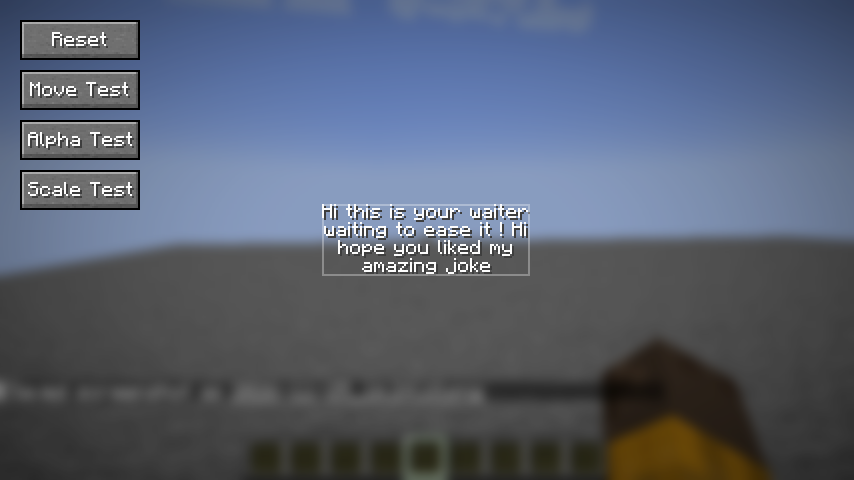
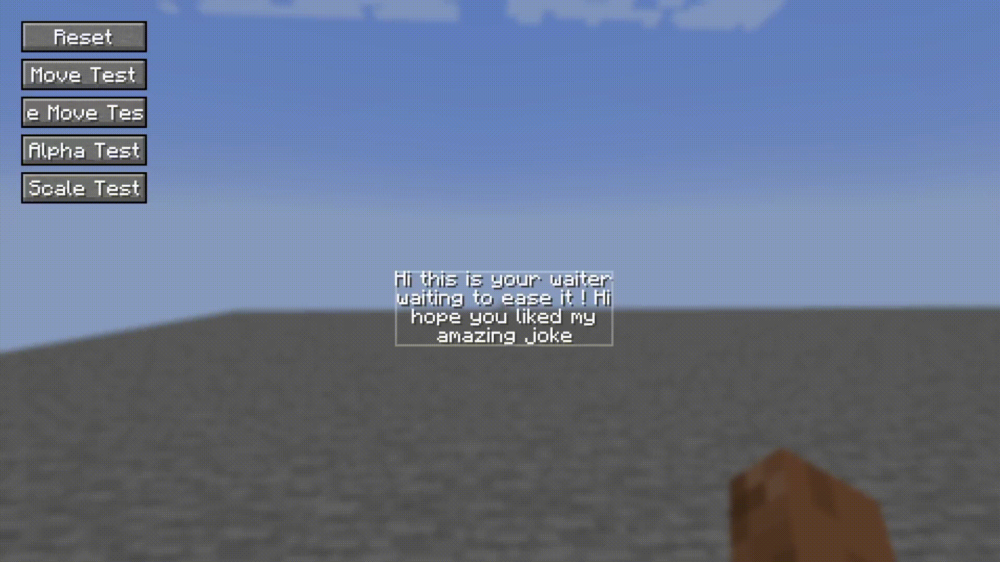
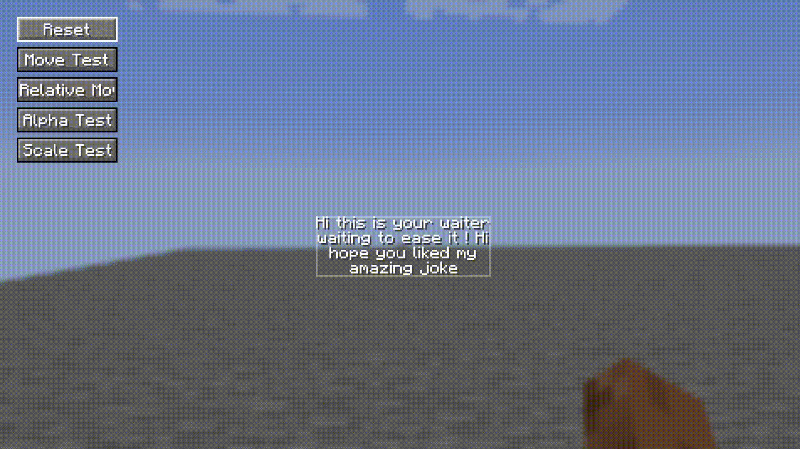

<div align="center">
    
</div>

# Waiter, ease it please !

"Waiter, ease it please !" is a very simply client-only library for Minecraft that enables you to
apply easing to Minecraft widgets.

## Downloading

To download "Waiter, ease it please !", put this into your `build.gradle`:

```build.gradle
repositories {
    maven { url = uri("https://jitpack.io") }
}

dependencies {
    modImplementation "com.github.geming400.ease-it:ease-it:[VERSION]" // eg: VERSION=1.0.1
}
```

And in your `fabric.mod.json`:

```json
{
  "depends": {
    "ease-it": ">=[VERSION]"
  }
}
```

## Usage

This mod makes every `Screen` and `AbstractWidget` (or `ClickableWidget` in yarn) implement the `Animatable` interface.
This interface makes you able to add `Animation`s to a given screen or widget.

### Adding animations

#### In screens

To add animations in a screen, use `easeit$addAnimation` on any `Screen` or `AbstractWidget` (or `ClickableWidget` in yarn) class:

```java
class MyScreen extends Screen {
    // ...
    
    protected void init() {
        // We add an animation to the widget's animation list
        // with the BOUNCE easing (IN_OUT) -> https://easings.net/#easeInOutBounce
        // that lasts for 1 second and moves to the
        // center of the screen (new Vector2i())
        
        var myWidget = /* ... */;
        myWidget.easeit$addAnimation(WidgetAnimation.ofInt(
                myWidget,
                Easing.BOUNCE, EasingType.IN_OUT,
                20, // 1 second (20 ticks = 1 second)
                Action.createMove(new Vector2i())
        ));
    }
}
```

You probably noticed the animation static constructor `WidgetAnimation.ofInt`.
There are 3 types of these:
- `WidgetAnimation.ofInt`
- `WidgetAnimation.ofFloat`
- `WidgetAnimation.ofDouble`

For example, if you have a position that you want to apply an easing to, and this position
uses integers, you're going to use `WidgetAnimation.ofInt`.

If you need another type for whatever reason, you can call `WidgetAnimation`'s constructor instead.

---

You can look at the `Easing` class for all the available easing that were implemented.

#### In HUDs

If you want to render dynamic hud elements, you can use `HudAnimation`s:

```java
GlobalAnimatable.getHud().easeit$addAnimation(HudAnimation.ofInt(
        Easing.EXPONENTIAL, EasingType.OUT,
        20 * 5,
        (drawContext, animation, progress, easingFunction) -> {
            Vector2ic pos = ActionHelpers.moveHelper(new Vector2i(10, 10), new Vector2i(10, 110), easingFunction, progress);
            drawContext.drawText(textRenderer, "Hello hi !", pos.x(), pos.y(), 0xFFFFFFFF, true);
        }
));
```

You can use the `ActionHelpers` class to get the results (target position, target size, ...) of the `Action` class.
Actions don't return anything, they only modify the given widget.

### Actions

Actions are what actually animate a widget.
They are represented using the `Action` functional interface.<br>
All "Waiter, ease it please !"'s actions can be found in the `Action` interface as static methods. As of v1.0.1 it
contains these ones:
- `Action.createMove`
- `Action.createResize`
- `Action.createAlpha`

Actions have a generic type, `T`. This type is the same as the `Animation` class generic type.

#### Making your own actions

To make your own "actions", you need to implement the `Action` functional interface.
This action executes each time the animation ticks and is what lets you modify a widget
depending on the easing.

To get the current progress of the easing, call `easing.get(progress)`, you can additionally specify a min and max argument.
By default the min and max arguments are:
- on `FloatEasing`: min = `0f`, max = `1f`
- on `DoubleEasing`: min = `0d`, max = `1d`
- on `IntEasing`: min = `0`, max = `100`

---

When making an action, you must not mutate directly a variable.
For example, this is safe:

```java
static Action<Float> createAlpha(@Range(from = 0, to = 1) float from, @Range(from = 0, to = 1) float to) {
    float clampedFrom = Math.clamp(from, 0, 1);
    float clampedTo = Math.clamp(to, 0, 1);

    return (widget, animation, easing, progress) ->
            widget.setAlpha(easing.get(progress, clampedFrom, clampedTo));
}
```

But this:

```java
static Action<Float> myAction() {
    float myMutableVar = Math.clamp(from, 0, 1);

    return (widget, animation, easing, progress) -> {
        myMutableVar = 0.6f; // THIS IS NOT ALLOWED
        // ...
    };
}
```

To write safe code, use `AtomicReference`s:

```java
static Action<Float> myAction() {
    AtomicReference<Float> myMutableVar = new AtomicReference<>(Math.clamp(from, 0, 1));

    return (widget, animation, easing, progress) -> {
        myMutableVar.set(0.6f); // THIS IS NOT ALLOWED
        // ...
    };
}
```

Effectively, **all variables should be final**.

#### Testing actions

To test your actions, you can use the "Debug Screen" this mod provides.
This screen can be opened by following the instructions in [Preview](#preview).

This screen is represented by the `EaseItTestScreen` class and has an api to allow registering your own tests:

```java
public class MyModClientInitializer implements ClientModInitializer {
    @Override
    public void onInitializeClient() {
        EaseItTestScreen.registerTest("My Action Test", screen -> {
            AlphaMultilineTextWidget testWidget = screen.testWidget;

            // ...
            
            return testWidget.easeit$addAnimation(Animation.ofInt(
                    testWidget,
                    Easing.EXPONENTIAL, EasingType.OUT,
                    20 * 5,
                    yourAction
            ));
        });
    }
}
```

To set a preview (like in the built-in tests), use the `EaseItTestScreen#startBorder`, `EaseItTestScreen#endBorder`
and `EaseItTestScreen#showWidgetBorder` fields.

## Preview

To preview what this mod does, when in a **development environment** or by setting the `-DEASE_IT_TEST_SCREEN_ALLOWED=true`
system property, you can open the "Debug Screen" by pressing the `O` key.







## Contributing

For setup instructions, please see the [Fabric Documentation page](https://docs.fabricmc.net/develop/getting-started/creating-a-project#setting-up) related to the IDE that you are using.

To run the tests, run the `test` gradle task: `./gradlew test`
